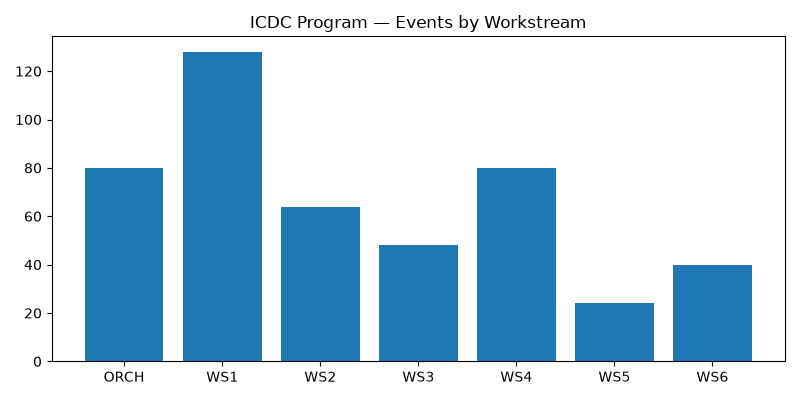

# 🛡️ ICDC Program (All-in-One Security Framework)
   🟥 Red Team Toolkit | For Adversary Simulation & Authorized Testing Only

The **ICDC Program** is a unified, Python-based cybersecurity orchestration framework that simulates and integrates **25 different security domains** into a single dashboard.


## 🚀 Features (The 25 Modules)
This tool consolidates:
- **Detect & Respond:** SIEM, SOC, IDS/IPS, EDR, Honeypot, MISP, SOAR, Forensics
- **Identity & Access:** IAM/SSO/MFA, PAM, Zero Trust
- **Vulnerability & Offensive:** Vuln Mgmt, PenTesting, Patch Automation
- **Network & Data:** Segmentation, WAF, Email Gateway, DLP, Backup/DR
- **Cloud & DevSecOps:** CSPM, CI/CD Security
- **Governance:** ISO 27001/SOC2, IR Playbooks, Phishing Awareness, Vendor Risk

## ⚙️ Architecture
The tool uses a phased execution model (Phase 1 to 4) to deploy these modules, feeding data into a centralized SQLite database (`icdc_program.db`) and generating unified KPI dashboards.
## 🧠 How It Works (Execution Flow)

The framework operates on a centralized orchestration model:

1. **Configuration:** All 25 modules are configured via `config.yaml` (defining vendors, targets, and settings).
2. **Phased Orchestration:** The `main.py` script triggers the `orchestrator.py`, which executes the security modules in 4 distinct phases (e.g., Phase 1: SIEM/IAM, Phase 2: SOC/Network).
3. **Data Ingestion & Logging:** Each module (Workstreams 1-6) processes its specific domain and logs events, findings, and compliance data into a centralized SQLite database (`icdc_program.db`).
4. **Metrics & Dashboarding:** Finally, `metrics/dashboard.py` queries the database, aggregates the KPIs (like MTTR, Vulnerability counts, Phishing click rates), and generates automated JSON data and PNG charts.
## 🛠️ Installation & Usage (Kali Linux)
1. Clone the repository:
   ```bash
   git clone https://github.com/sanankhan318112233-boop/ICDC-All-in-One-Security-Tool.git
   cd ICDC-All-in-One-Security-Tool
